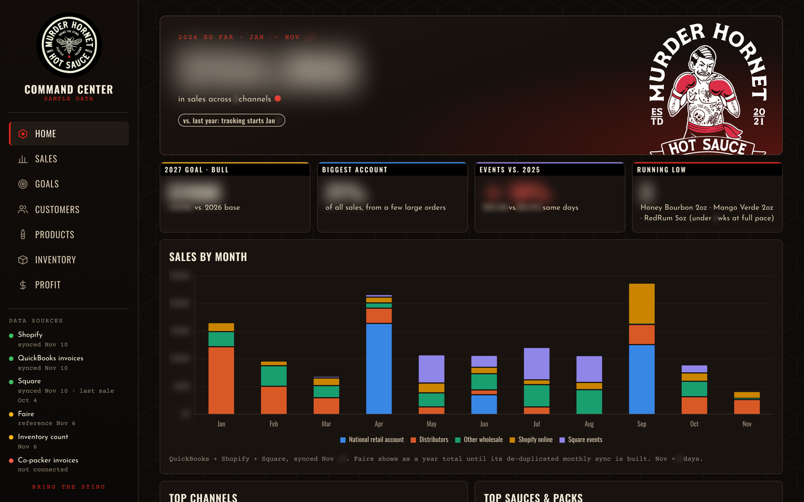
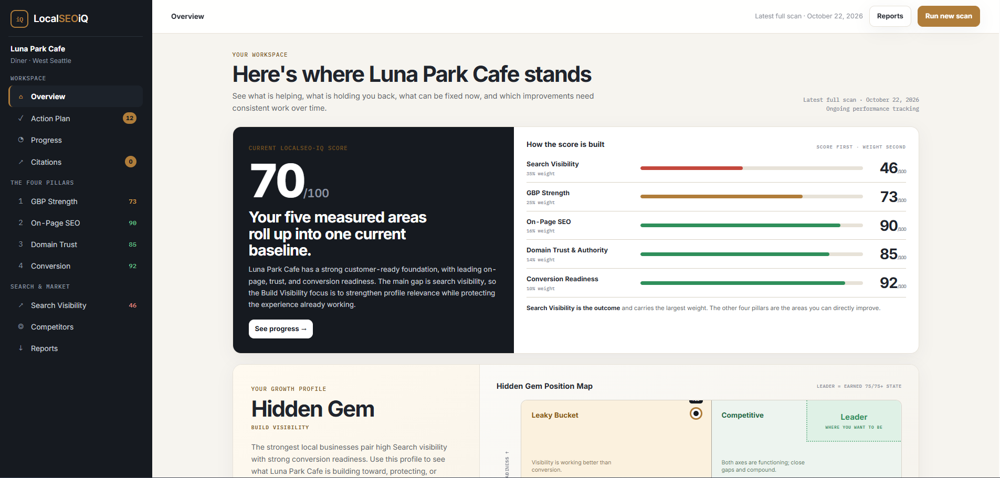

# Shane Crockett

**Growth & strategy leader | AI-enabled product builder | Financial services & enterprise technology**

My career has centered on business growth, strategic partnerships, and financial services. Increasingly, I use AI and modern development tools to turn business problems into working products: defining the opportunity, setting requirements, directing AI-assisted engineering, and validating the results.

I'm also a **Co-Owner of Murder Hornet Hot Sauce**, focused on **Growth, Operational Optimization & Financial Strategy**. The projects below reflect a practical approach to AI: **identify a problem, build a solution, and make it useful.**

## Featured projects

### Murder Hornet Command Center — AI-enabled business operations

**From fragmented sales and financial data to a dependable operating view.** I led the build of a secure, mobile-first command center connecting Shopify, Faire, Square, QuickBooks Online, and inventory reporting. I owned the business requirements, product direction, data validation, and deployment, working with Claude as an AI engineering agent.

[**Explore the case study and screenshots →**](projects/mhhs-command-center.md) · Application and source repository: private

### LocalSEO-iQ — AI-assisted SaaS product development

**Making local search intelligence actionable for small businesses.** A privately developed SaaS platform combining Google Business Profile signals, search visibility, website assessments, competitive intelligence, and prioritized recommendations. The work spans product strategy, data methodology, technical integrations, UX, and ongoing testing.

[**Explore the product walkthrough and screenshots →**](projects/localseo-iq.md) · Application source repository: private

### BitcoinMath.org — Interactive financial modeling

**Turning complex financial questions into hands-on tools.** I created a public library of interactive calculators that help users explore saving, borrowing, retirement, income strategies, and Bitcoin-related financial decisions. Visitors can adjust assumptions, compare scenarios, and see how the math changes.

[**Explore the case study →**](projects/bitcoinmath.md) · [**Try the live calculators →**](https://bitcoinmath.org/calculators/)

## How I build

- **Start with the business challenge:** Define the user problem, the opportunity, and what success looks like.
- **Use AI to accelerate execution:** Translate business requirements into design, engineering, analysis, testing, and iterative improvements.
- **Stay accountable for results:** Check the data, logic, assumptions, edge cases, and user experience before trusting the output.

---

**Portfolio note:** These pages showcase product thinking, architecture, design, and practical AI fluency. Proprietary code, credentials, customer data, and internal financial records are not published here.
