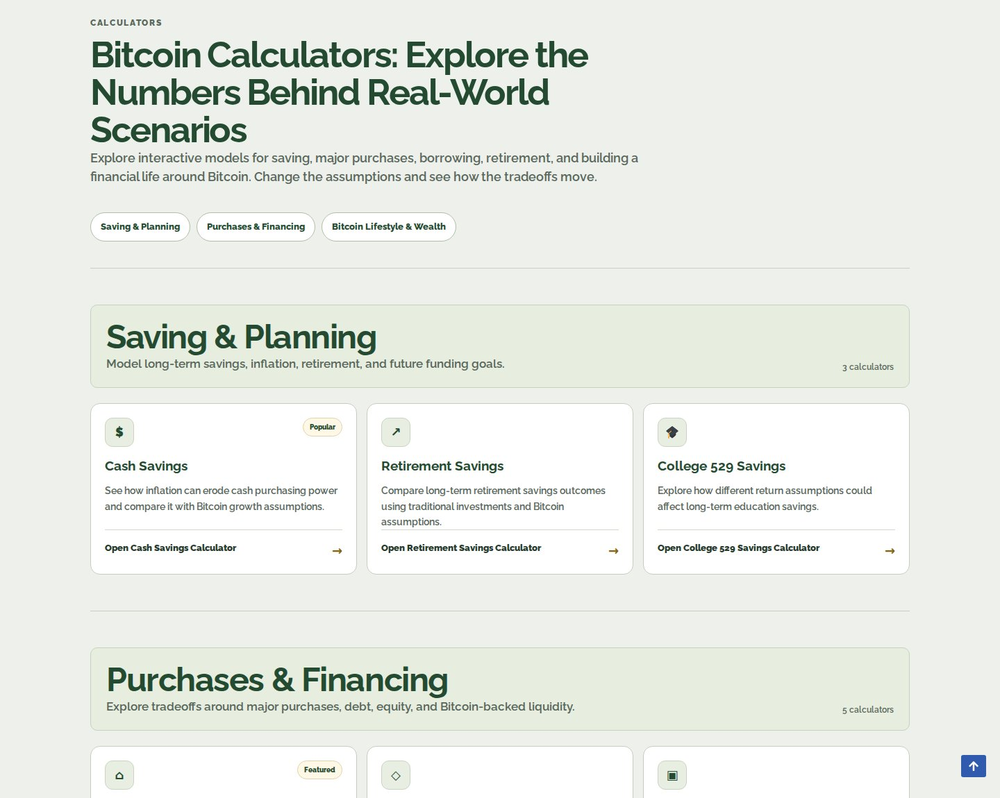
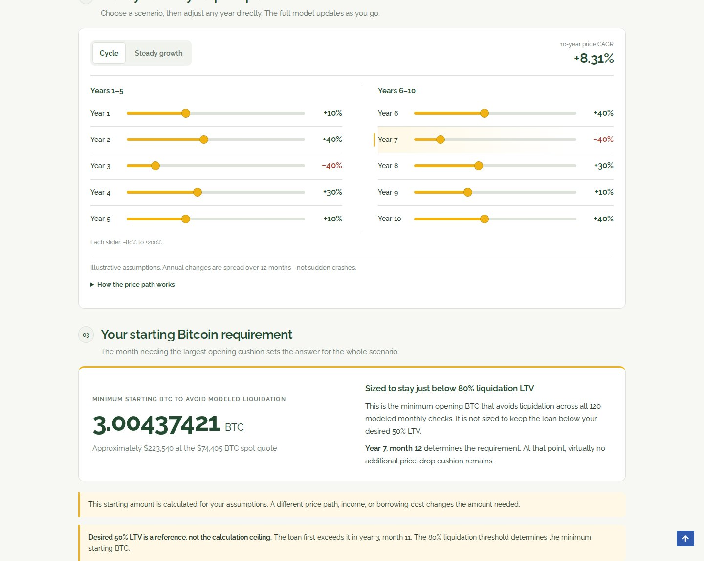
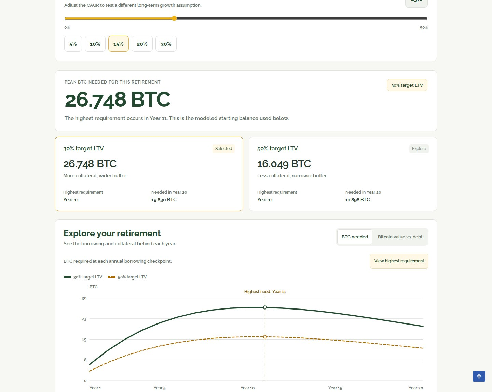
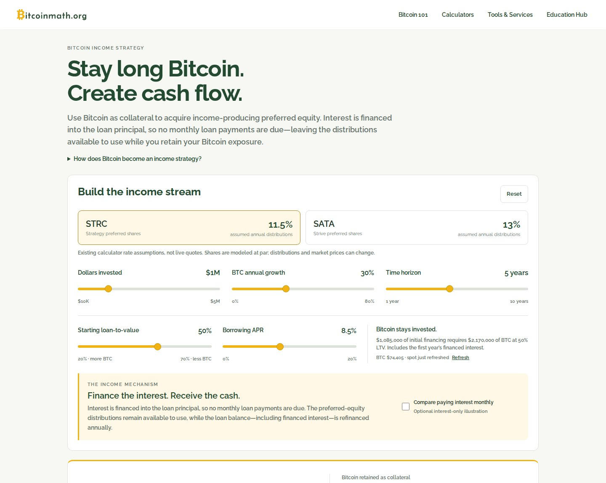

# BitcoinMath.org

**Interactive financial modeling · Bitcoin education · AI-assisted product development**

[**Explore the live calculator library**](https://bitcoinmath.org/calculators/) · [Back to the projects overview](../README.md)

## Why I built it

Financial decisions often come down to tradeoffs that are difficult to understand from an article, spreadsheet, or one-size-fits-all recommendation. I built **BitcoinMath.org** to make those tradeoffs tangible: change the assumptions, see the math, and explore how different choices play out over time.

The goal is not to predict Bitcoin's price or tell people what to do. It's to make complex financial scenarios more approachable through interactive, transparent models.

## What the platform does

BitcoinMath brings together a growing library of calculators for **saving, major purchases, borrowing, income strategies, and long-term financial planning**. Visitors can change inputs such as expenses, inflation, loan terms, loan-to-value ratios, and hypothetical Bitcoin returns, then inspect how those inputs affect the results.

The calculators connect three layers:

1. **Inputs and assumptions** — clear controls that let users test their own scenarios.
2. **Modeling and analysis** — multi-year calculations that compare paths, cash flows, debt, collateral, and potential outcomes.
3. **Interpretation** — visualizations, comparisons, and plain-English explanations of what changed and why.

### Featured interactive models

| Experience | What it demonstrates |
| --- | --- |
| **[Bitcoin Standard Readiness](https://bitcoinmath.org/calculators/living-a-btc-standard-getting-started/)** | Ten-year price-path modeling with editable annual scenarios, monthly calculations, loan-to-value and liquidation-risk analysis, and a calculated starting BTC requirement. |
| **[Retire on Bitcoin](https://bitcoinmath.org/calculators/retire-on-btc/)** | Twenty-year retirement-expense borrowing scenarios comparing 30% and 50% target LTV, peak collateral requirements, debt, and hypothetical year-end balance sheets. |
| **[Bitcoin Income Strategy](https://bitcoinmath.org/calculators/bitcoin-income-strategy/)** | Compare Bitcoin-backed borrowing, preferred-equity income assumptions, financing structures, monthly cash flow, and a buy-and-hold baseline. |
| **[Living a Bitcoin Standard](https://bitcoinmath.org/calculators/btc-living-expenses/)** | Explore long-term effects of inflation, income growth, Bitcoin accumulation assumptions, and borrowing for living expenses. |

[**Browse all the calculators →**](https://bitcoinmath.org/calculators/)

## Product and technical approach

My role spans product direction, financial scenario design, user experience, website implementation, and AI-assisted development. I translate the financial question into requirements, define the assumptions and edge cases, direct engineering iterations, evaluate the outputs, and refine how the model communicates its results.

| Layer | Approach |
| --- | --- |
| Product strategy | Start from a practical financial question; make assumptions and tradeoffs understandable |
| Financial modeling | Multi-year scenario calculations, cash-flow comparisons, borrowing and collateral math |
| User experience | Editable assumptions, interactive charts and tables, readable explanations |
| Website | WordPress-based public experience with custom interactive calculator functionality |
| AI-assisted workflow | Use AI as a development and iteration partner while retaining responsibility for product decisions and output review |

The hard part isn't only building a calculator interface. It's making the underlying assumptions, risk exposures, and limitations legible enough that someone can challenge and learn from the model.

## What this demonstrates

- **Problem identification:** Turn a complicated subject into a focused, useful product.
- **Technical fluency:** Coordinate AI-assisted development, financial logic, and interactive web experiences.
- **Systems thinking:** Connect inputs, calculation rules, risk conditions, visualizations, and explanations.
- **End-to-end execution:** Move from idea to a publicly accessible product, then continuously improve it.

## Visual walkthrough

*Screenshots captured from the live public calculators on November 11, 2026. Figures are illustrative outputs from example assumptions, not investment forecasts. Click through to the live tools to change the inputs yourself.*

### 01 · A library of financial models

Saving, financing, retirement, borrowing, and Bitcoin lifestyle decisions organized around real-world questions.

### 02 · Bitcoin Standard Readiness: model a full decade

Editable annual Bitcoin price paths feed a ten-year simulation. The model calculates the starting BTC requirement needed to remain below its assumed liquidation threshold at every monthly checkpoint.

### 03 · Retire on Bitcoin: connect spending, debt, and collateral

A twenty-year model compares 30% and 50% target loan-to-value paths, identifies peak collateral requirements, and charts the relationship between borrowing needs and Bitcoin holdings.

### 04 · Bitcoin Income Strategy: explore financing economics

Loan-to-value, borrowing APR, modeled preferred-equity distributions, and time horizon combine to illustrate cash-flow tradeoffs alongside a hold-Bitcoin baseline.

**[Try the live calculators at BitcoinMath.org →](https://bitcoinmath.org/calculators/)**

## Scope and limitations

These are educational models, not forecasts or financial advice. Results depend on user-selected assumptions and may exclude taxes, transaction costs, lender-specific terms, liquidation mechanics, refinancing availability, or other risks unless explicitly modeled. The site is public; this portfolio page is a product case study, not a publication of its complete WordPress source code.

[Back to the projects overview](../README.md)
