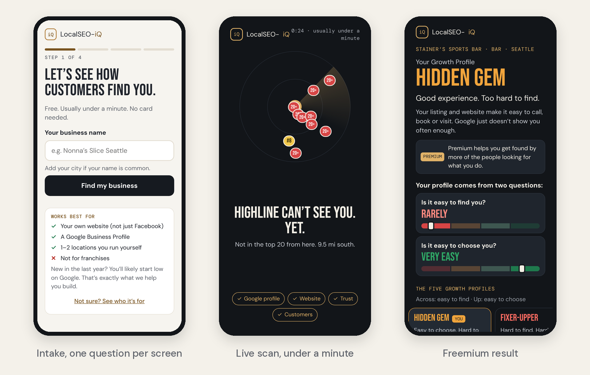
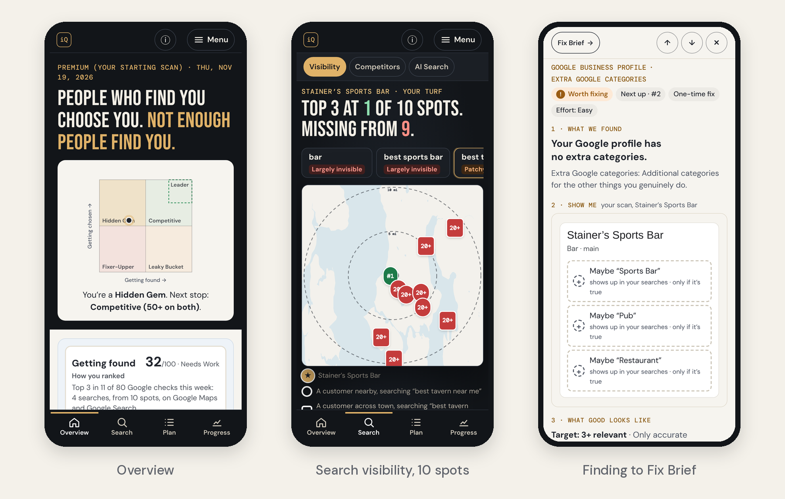
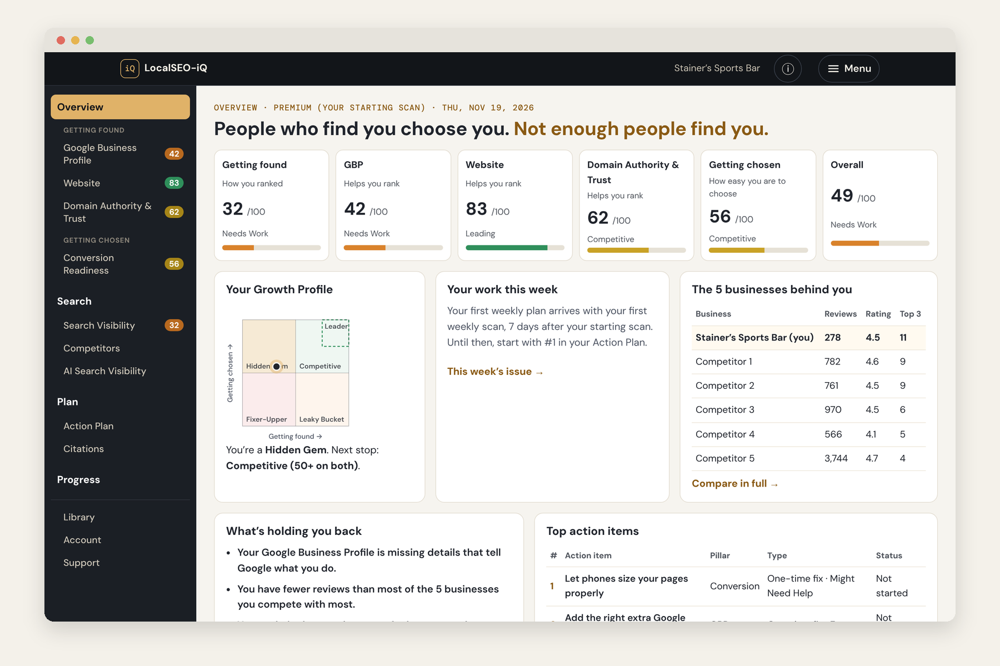

# LocalSEO-iQ

**Local search intelligence for independent businesses · Private-source SaaS, in development**

LocalSEO-iQ measures how a local business shows up when nearby customers search, explains why in plain English, and turns the findings into a prioritized plan. It's built for owners of one or two locations who want to understand and improve their local search presence themselves, or hand the work to their own staff.

[← Back to the projects overview](../README.md)

## How it works

| | |
| --- | --- |
| **Freemium** | A free scan in under a minute: one search checked from 10 real locations around the business, plus a first read on its listing, website, authority and customer experience. The result is a Growth Profile in plain language. |
| **Premium** | A full scan of four searches from the same 10 locations on Google Maps and Google Search (80 checks), the four pillars below, competitor comparisons and AI search visibility. The result is a dashboard with an Action Plan, Fix Briefs and a library of vetted citation sources. |
| **Weekly** | The same full scan runs every week. Progress is tracked against the starting scan and summarized in a weekly email. |

**What's measured:** Search Visibility (where the business ranks) plus four pillars, grouped by whether they help a business *get found* or *get chosen*:

- **Getting found:** Google Business Profile · Website (on-page SEO) · Domain Authority & Trust
- **Getting chosen:** Conversion Readiness (how easy it is to call, book or visit)

## Screens

The screens below show a real November 2026 scan of a Seattle sports bar. The business is renamed **Stainer's Sports Bar** and competitor names are masked. Scores and rankings are as measured. Premium screens are from the beta dashboard.

*Freemium: intake, the scan in progress, and the result.*

*Premium on a phone: Overview, search visibility across 10 spots, and a finding leading to its Fix Brief.*

*Premium on desktop: the same data with room to work.*

## Under the hood

| Area | Approach |
| --- | --- |
| Data | Google search and business data, website crawling and performance, authority and link data, and AI assistant answers, from established third-party providers |
| Processing | Python measurement and scoring; Node.js API and services |
| Orchestration | Background workers, Redis queues, MongoDB |
| Front end | Phone-first web app; React dashboard |
| Build | Product, UX and engineering directed by me, built with Claude as an AI engineering agent |

## Status

In development, preparing for a first group of customers. The application, its source and customer data are private.

[← Back to the projects overview](../README.md)
