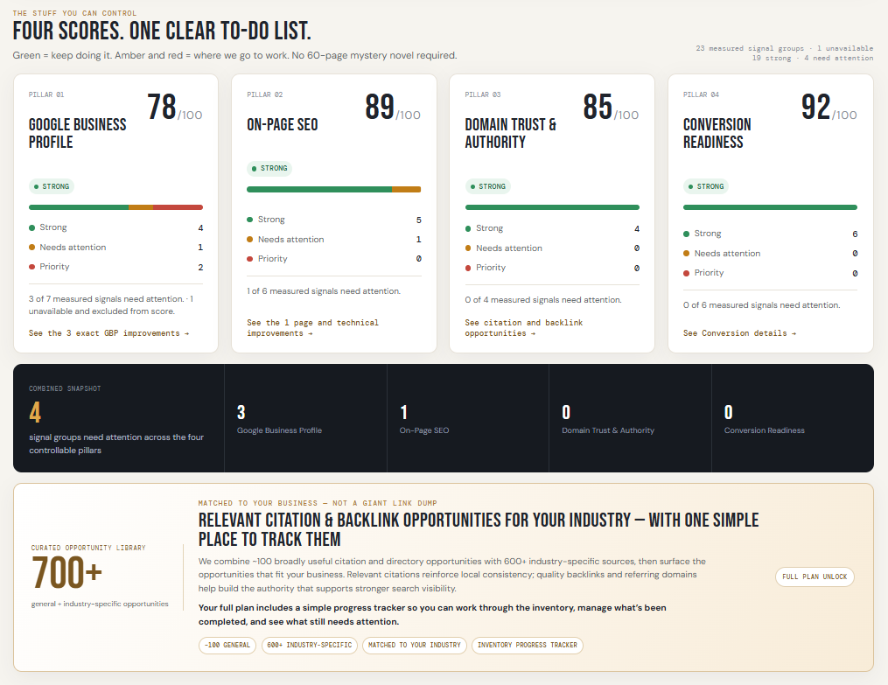
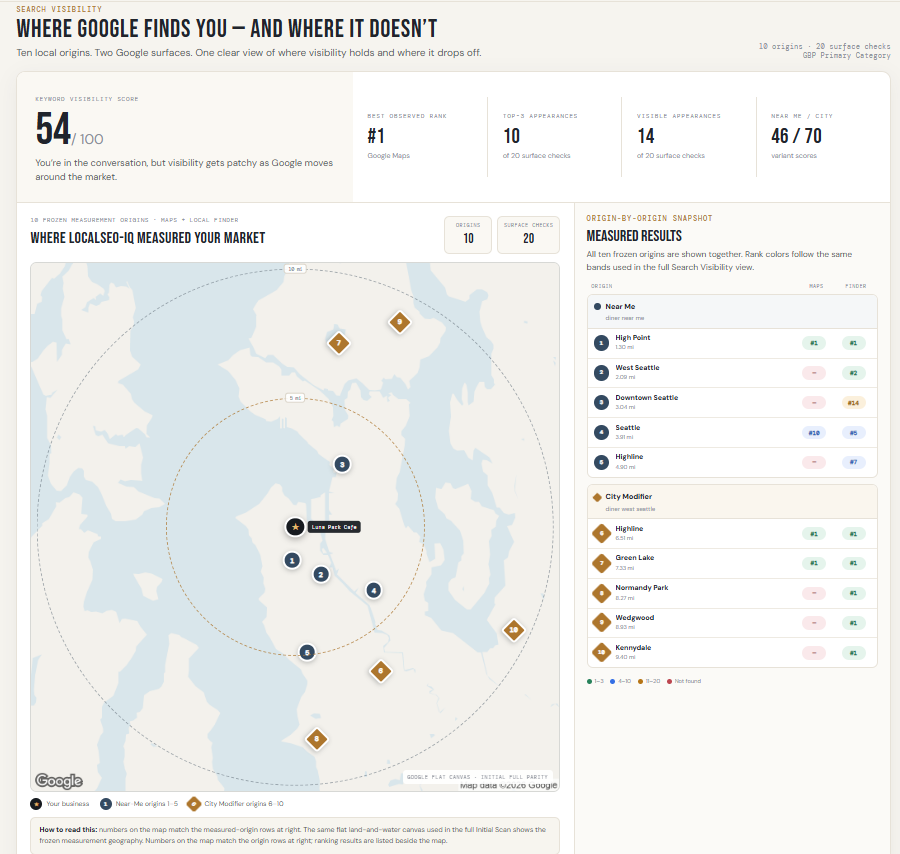
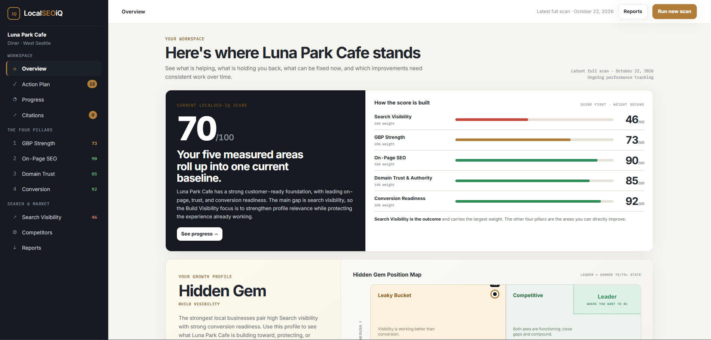
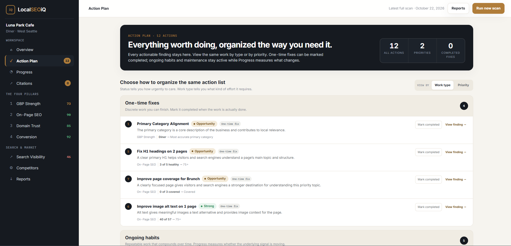
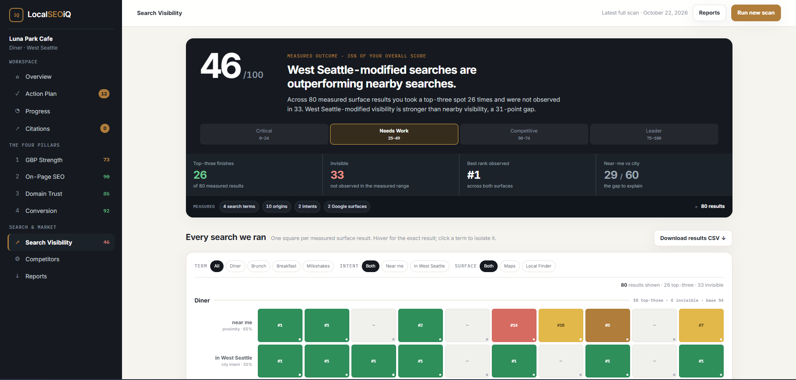
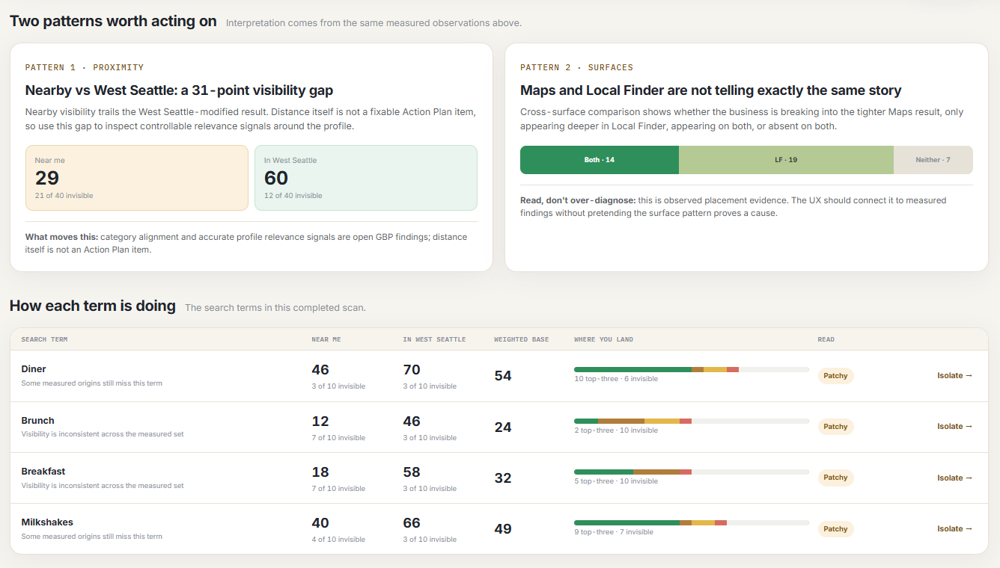
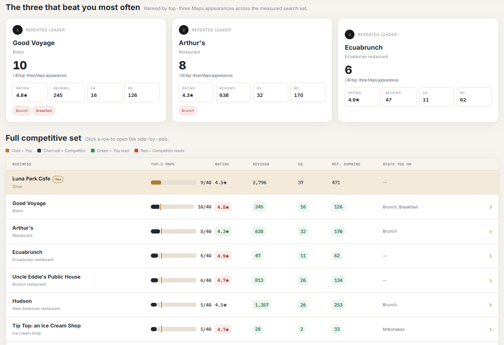

# LocalSEO-iQ

**Local search intelligence · Automated measurement and reporting · Private-source SaaS project**

LocalSEO-iQ brings local search visibility, Google Business Profile signals, website assessments, and conversion readiness into a customer-facing workspace. The product connects an introductory **Free Snapshot** with a more detailed **Initial Full** baseline, an action-oriented dashboard, and a recurring measurement experience under development.

[← Back to the projects overview](../README.md)

## Product walkthrough

The screenshots below were supplied for this portfolio as an example **Luna Park Cafe** interface. They illustrate product design and interactions, **not independently audited business performance**. The Free Snapshot and Initial Full views have different measurement scopes; their scores should not be read as a before-and-after performance change.

### 01 · Free Snapshot

The introductory assessment summarizes four controllable areas: Google Business Profile, On-Page SEO, Domain Trust & Authority, and Conversion Readiness. The results direct customers toward the next actions rather than only displaying scores.

*Four controllable pillars, measured-signal breakdowns, and an attention summary.*

The Search Visibility preview uses a smaller measurement set across ten geographical origins and two Google surfaces, with the origin map alongside observed results.

*Free Snapshot: ten measurement origins and twenty surface checks. [Open the full-size image](../assets/localseo-iq/free-search-map.png).*

### 02 · Initial Full — Overview

The paid dashboard combines Search Visibility with the four controllable pillars. The Overview offers a current weighted baseline, an explanation of its component scores, and a Growth Profile for context.

*Overview: current score and its components, with deeper navigation into the workspace.*

### 03 · Initial Full — Action Plan

Evidence-backed work is organized as actionable tasks. The interface supports different views of the same list and separates work that has been marked completed from improvement verified by later measurements.

*Action Plan: work grouped by type, with item-level evidence links and completion controls.*

### 04 · Initial Full — Search Visibility

The expanded Search view shows the measurement scope, individual search outcomes, and filters for terms, intent, and Google surface. The example below displays four terms measured across ten origins and two surfaces, producing 80 observations.

*Search Visibility: a detailed ranking grid with term and surface filters.*

An interpretation layer makes patterns legible: near-me versus city-modified queries, Maps versus Local Finder, and individual search-term summaries.

*Search interpretation: observations and comparisons that sit alongside the raw grid.*

The competitive view shows repeat leaders and a fuller comparison table rather than a disconnected list of competitors.

*Competitive context: repeated leaders and market-wide comparison.*

<!-- Progress page screenshot is intentionally not included until an authentic example is provided. -->

## Behind the experience

| Area | Implementation approach |
| --- | --- |
| Measurement | External search, business, performance, authority, and web evidence sources |
| Processing | Python-based measurement and analysis with JavaScript/Node.js services |
| Orchestration | Background workers, Redis queues, and MongoDB persistence |
| Customer experience | Free intake, paid onboarding, dashboard views, reporting, and action tracking |
| AI-assisted workflows | Interpretation, product iteration, testing, and engineering collaboration |

The ongoing engineering work involves coordinating several external services, website crawling, PageSpeed Insights timing, result accuracy, and distinguishing **unavailable measurements** from genuine zero scores. Customer-completed actions are not automatically equivalent to independently verified improvement.

## Scope and availability

The application repository and customer data are private. These screenshots show a sample interface and do not establish that every recurring workflow, measurement, or score has been independently accepted for production use.

[← Back to the projects overview](../README.md)
