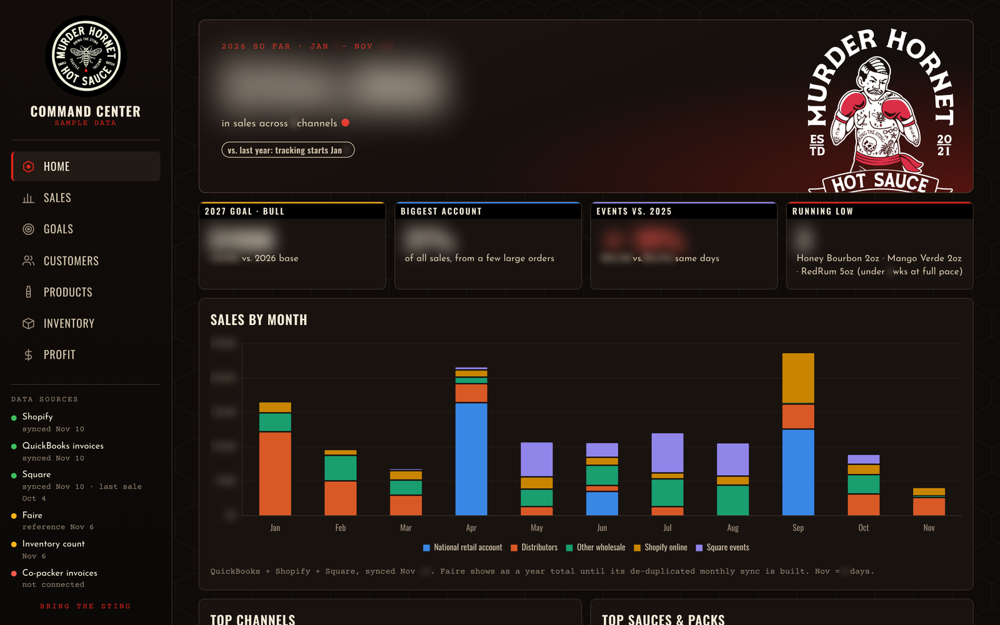
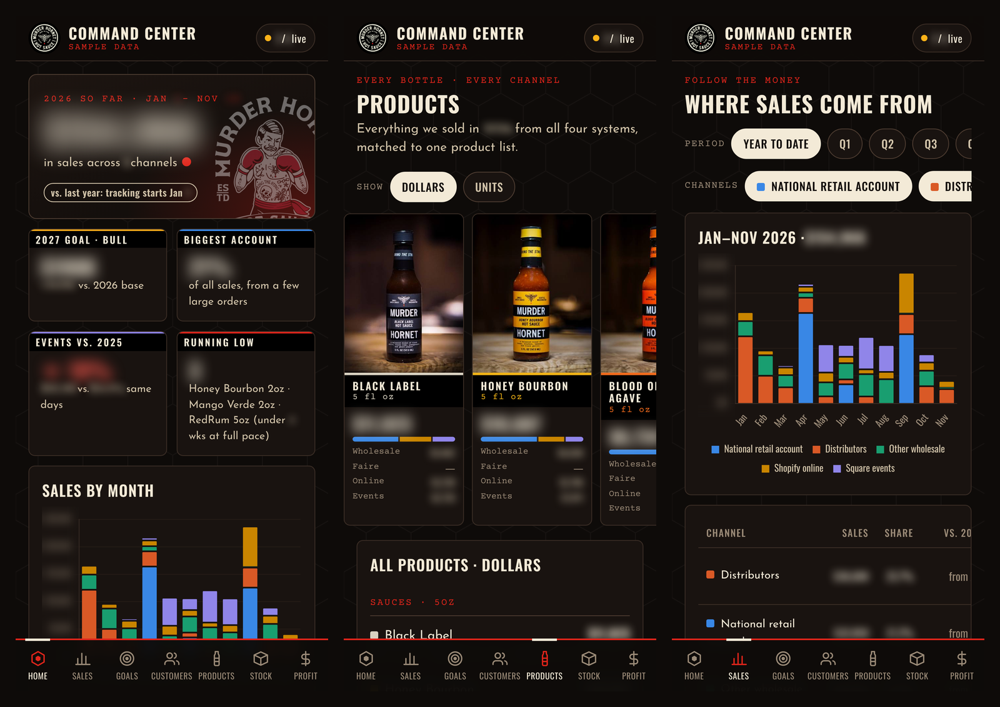
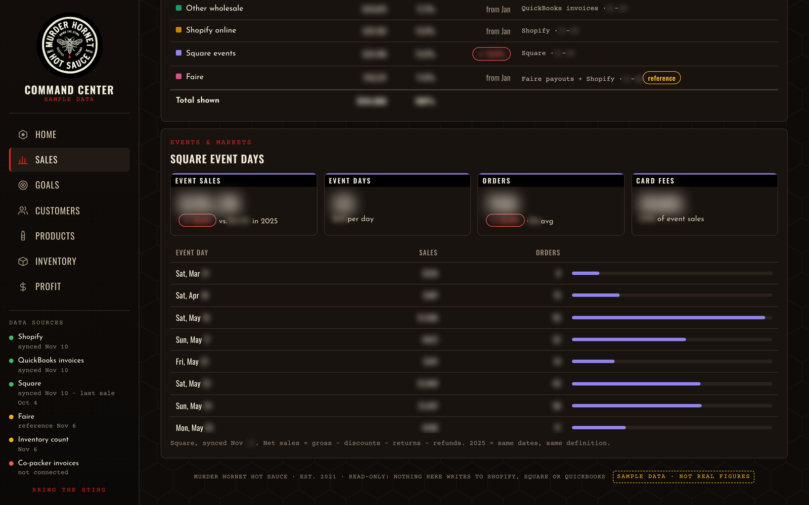
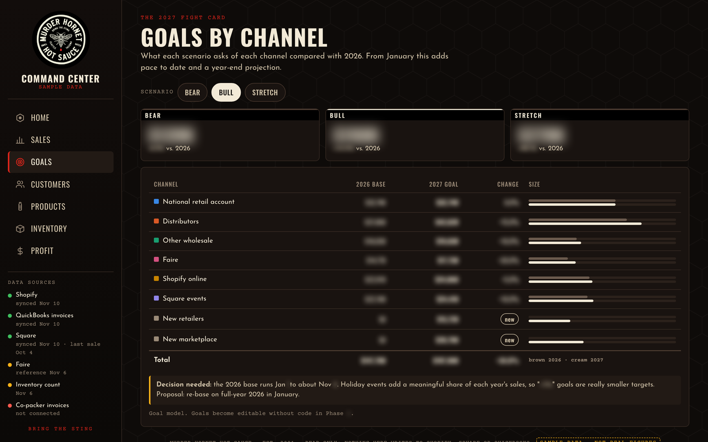
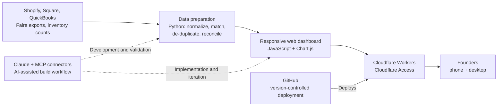

# Murder Hornet Command Center

**From disconnected business data to a useful operating tool — designed and shipped with AI.**

Our Seattle food brand, Murder Hornet Hot Sauce, sells across retail, distributors, direct wholesale, e-commerce and events. We had plenty of data, but no reliable, convenient way for our three part-time founders to see the whole business. I saw an opportunity to solve that problem myself.

I defined and led the development of a secure, mobile-first command center that brings sales, customers, products, inventory, goals and financial reporting into one place. I used Claude as an AI engineering agent, but I owned the product direction, business logic, validation and decisions throughout the build.

[← Back to projects](../README.md)

## The project at a glance

| | |
| --- | --- |
| **My role** | **Co-Owner — Growth, Operational Optimization & Financial Strategy.** Identified the opportunity, set product and data requirements, directed the AI-assisted build, validated results and guided deployment |
| **Business systems** | Shopify, Faire, Square, QuickBooks Online and physical inventory records |
| **Technology** | Claude with Model Context Protocol (MCP) connectors, Python, HTML/CSS/JavaScript, Chart.js, GitHub, Cloudflare Workers and Cloudflare Access |
| **Delivery** | Private, access-controlled application deployed in two working sessions; subsequent improvements and validation |
| **Data refresh** | On demand today; scheduled synchronization is on the roadmap |
| **By the numbers** | 4 business systems integrated · 65 source item names matched to 19 products · 37 logged decisions · $0/month hosting at current scale |

## The problem I wanted to solve

Murder Hornet sells through six channels, but its operating information was spread across multiple systems, each with different labels, dates and reporting conventions. Getting a clear answer to a simple question often required downloading reports, comparing spreadsheets and checking whether the numbers were even comparable.

That fragmentation created practical problems:

- **Visibility:** How are sales performing versus last year and our goals? Which channels and accounts are driving growth?
- **Trust:** The same products had different names across systems, and copied or split marketplace orders could inflate totals if counted twice.
- **Planning:** Inventory counts sat apart from sales trends, making production timing harder to judge.
- **Decision-making:** Profitability, customer concentration and investment priorities were difficult to evaluate from one consistent view.

The goal was not to build another pretty dashboard. It was to give the founders **one dependable place to understand the business and decide what to do next**.

## What I built

A branded, phone-first command center designed for a quick daily check-in or a deeper look at performance.

| View | What it helps us do |
| --- | --- |
| **Home** | See year-to-date sales, goal progress, channel trends, customer concentration and inventory alerts |
| **Sales and customers** | Compare periods and channels; identify key wholesale accounts |
| **Products** | Compare product performance across systems using a common product catalog |
| **Inventory** | Review stock on hand and estimated weeks of supply using the current sales pace |
| **Goals** | Model bear, bull and stretch scenarios by channel and monitor progress |
| **Profit** | Bring high-level financial performance into the same operating conversation |

Every reporting view is designed to show where its data came from and when it was last refreshed. The interface uses Murder Hornet's own brand identity and adapts from a desktop navigation rail to a touch-friendly phone layout.

## Product walkthrough

*These screenshots are illustrative, not company financial disclosures. Customer and distributor names are fictional; financial figures are obscured.*

### Executive overview

A concise view of revenue, performance indicators and channel activity, styled with the actual Murder Hornet brand.

### Designed for the phone

A bottom navigation bar, swipeable product cards and stacked layouts make the dashboard practical for founders checking in between other responsibilities.

### Sales, events and goals

Channel performance, event comparisons and scenario planning help turn reporting into useful operating conversations.

## The hard part wasn't the interface. It was making the data trustworthy.

Combining reports is easy to describe and much harder to do correctly. I specified the rules, investigated discrepancies and used the AI agent to implement and test the transformations.

| Challenge | How I addressed it |
| --- | --- |
| One sauce appeared under different names in different systems | Built a common product-matching layer |
| Marketplace orders were copied or split across systems | De-duplicated orders and cross-checked against Faire payout exports, flagging exceptions for review |
| Reporting dates and sales conventions differed | Defined consistent timing rules for the operating dashboard and investigated timestamp discrepancies |
| Some mixed packs did not identify their individual flavors | Kept the unknown quantities explicit instead of inventing product-level estimates |
| Totals needed to be defensible | Checked channel figures against source-system reports, targeting reconciliation within 0.5% |

These decisions matter because an attractive dashboard with incorrect numbers can lead to worse decisions than no dashboard at all.

## How I used AI to build it

This project demonstrates how I approach AI: **start with a business problem, define the outcome, use the tools available, and verify the work.**

I worked with Claude as an engineering agent using MCP-connected business systems and a conventional development stack. I translated business needs into requirements, asked the agent to propose approaches and trade-offs, directed implementation, tested outputs against the source reports and iterated on the design and data logic.

The AI agent helped write code and accelerate execution. **I remained accountable for what the numbers meant, how the product should work, which trade-offs to accept and whether the results were reliable.** I also maintained a dated decision log and open-issues list rather than treating a working demo as a finished product.

### Architecture, in brief

Source access was read-only wherever connected. Faire data was incorporated through exports. Cloudflare Access restricts the deployed application to named users; the application and source repository are not public. At the current scale, Cloudflare hosting is within its free tier, excluding any other tools or business-system costs.

## Business value

The immediate improvement is operational clarity: rather than assembling separate reports whenever someone needs an answer, the founders can use a single interface with consistent definitions and visible data provenance.

| Before | With the Command Center |
| --- | --- |
| Manual reporting across disconnected systems | A consolidated view of sales, customers, products and financial performance |
| Inconsistent product names and potential duplicate sales | Defined matching, de-duplication and reconciliation rules |
| Inventory counts separated from demand | Stock levels viewed alongside sales pace and low-stock alerts |
| Hard-to-see channel trends and account concentration | Channel comparisons, goal scenarios and customer concentration in one place |
| Reporting required time and outside support | A foundation for faster in-house analysis and lower recurring reporting effort |

**What I can demonstrate today:** a deployed, access-controlled product; an integrated reporting experience; documented data-quality rules; and a repeatable way to translate a business need into working software. Time savings, ongoing operating-cost reductions and decision improvements are the intended benefits, not independently measured outcomes yet.

## What comes next

The next priorities are scheduled data refreshes, deeper channel-level profitability, co-packer invoice inputs for more precise unit costs, and simpler logging of samples and giveaways.

## Why I chose to share this

For me, AI fluency is not just knowing how to use a model or generate code. It is recognizing a real problem, structuring it clearly, connecting the right tools, making informed trade-offs and holding the output to a business standard. This is one example of that approach in practice.

*The live application, code repository and underlying business data remain private.*
